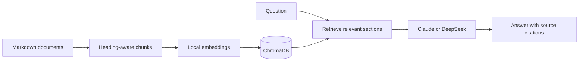

# rag-observability — Cited Answers from Observability Docs

[](https://github.com/redbarron23/rag-observability/actions/workflows/ci.yml)
[](LICENSE)

**Find answers in your observability documentation and see the supporting sources.**
This local retrieval-augmented generation (RAG) pipeline indexes Markdown documents, retrieves relevant
sections, and asks Claude or DeepSeek to answer with document and section citations.


## Quick start

Requirements: Python **3.10+**. Embedding runs locally on CPU; the embedding model downloads on first use.

```bash
git clone https://github.com/redbarron23/rag-observability.git
cd rag-observability
python -m venv .venv
source .venv/bin/activate
python -m pip install -r requirements.txt
python ingest.py
python evals.py
```

This indexes the bundled fictional corpus and runs retrieval checks without a provider key.
To generate an answer, configure a provider:

```bash
export ANTHROPIC_API_KEY=your-key
python query.py "What is the coverage target for Tier 1 production resources?"
```

For DeepSeek, set `DEEPSEEK_API_KEY` and pass `--provider deepseek`.
Generated answers use a hosted LLM and may incur provider charges. See [the guide](docs/guide.md#quick-start).

## How it works



Ingestion preserves heading breadcrumbs. Retrieval searches a local vector database; generation
receives the selected chunks and is prompted to cite each factual claim. Retrieval and answer
quality are evaluated separately.

## Quality and limits

- The included corpus contains **eight fictional observability documents**, not customer material.
- Retrieval evals check expected sources for ten questions. Passing on this small corpus does not
  establish quality on an unseen estate; adapt the eval cases for your own documents.
- Citations are generated by an LLM. Check that the cited section actually supports the answer.
- `--max-distance` can exclude weak matches; tune it on your own corpus rather than assuming the
  bundled examples define a production threshold.
- Embeddings and the vector store stay local. Relevant retrieved text is sent to the configured
  provider when generating an answer; use documents approved for that destination.

## Documentation

| Topic | Guide |
| --- | --- |
| Full walkthrough and CLI options | [Usage guide](docs/guide.md#usage-examples) |
| Pipeline and module map | [Architecture](docs/guide.md#the-rag-pipeline-detailed) |
| Heading-aware chunking | [Chunking strategy](docs/guide.md#chunking-strategy) |
| Retrieval and generation | [Retrieval](docs/guide.md#retrieval-how-it-works), [generation](docs/guide.md#generation-the-cited-answer) |
| Source attribution and fact checks | [Evaluation](docs/guide.md#evaluation-strategy) |
| Use your own corpus | [Data handling](docs/guide.md#data-handling) |

## Development

```bash
python -m pip install -r requirements-dev.txt
python -m ruff check .
python -m pytest tests/ -q
python ingest.py
python evals.py
```

CI runs Ruff linting, unit tests, ingestion, and retrieval evals. Generation evals (`python evals.py --with-llm`)
are opt-in and call the configured provider.

Follow the [open-source roadmap](https://github.com/users/redbarron23/projects/2).

## License

MIT. See [LICENSE](LICENSE).
