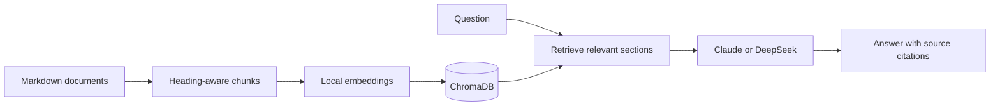

# rag-observability — Cited Answers from Observability Docs

[](https://github.com/redbarron23/rag-observability/actions/workflows/ci.yml)
[](LICENSE)

**Find answers in your observability documentation and see the supporting sources.**
This local retrieval-augmented generation (RAG) pipeline indexes Markdown documents, retrieves relevant
sections, and asks Claude or DeepSeek to answer with document and section citations.


## Quick start

Requirements: Python **3.10+**. Embedding runs locally on CPU; the embedding model downloads on first use.

```bash
git clone https://github.com/redbarron23/rag-observability.git
cd rag-observability
python -m venv .venv
source .venv/bin/activate
python -m pip install -r requirements.txt
python ingest.py
python evals.py
```

This indexes the bundled fictional corpus and runs retrieval checks without a provider key.
To generate an answer, configure a provider:

```bash
export ANTHROPIC_API_KEY=your-key
python query.py "What is the coverage target for Tier 1 production resources?"
```

For DeepSeek, set `DEEPSEEK_API_KEY` and pass `--provider deepseek`.
Generated answers use a hosted LLM and may incur provider charges. See [the guide](docs/guide.md#quick-start).

## Local web interface

```bash
python -m pip install -r requirements-ui.txt
python ingest.py
python -m streamlit run app.py --server.address 127.0.0.1 --server.fileWatcherType none
```

Open the local URL printed in the terminal. **Find sources** needs no provider key: inspect
ranked chunks, source documents, sections, and cosine distances. Adjust the chunk count and
distance cutoff in the sidebar. **Generate answer** uses the same `LLM_PROVIDER`, `LLM_MODEL`,
and provider API-key environment variables as the CLI. Set them before starting Streamlit.
Each question is independent; earlier questions are not sent as conversation history.

To add documents, use **Add documents** in the sidebar: choose one or more `.md` files,
then click **Upload and index**. Files must be UTF-8 text with at least 50 characters of
usable content, up to 5 MB each. Uploads are saved under `data/uploads/` (excluded from Git).
The selected index is updated from all documents in `data/`, including existing uploads;
only new or changed files are embedded, and the cached engine is cleared automatically. Different contents with the same filename
are kept separately; identical re-uploads reuse the saved file. See [data handling](docs/guide.md#data-handling)
for command-line ingestion, document structure, and rebuild limitations.

Re-running `python ingest.py` embeds only added or changed files, drops deleted ones, and
does nothing when sources are unchanged; `python ingest.py --rebuild` re-embeds everything.
See [incremental ingestion](docs/guide.md#incremental-ingestion).
After re-ingesting documents, click **Reload index** to reload the cached engine.
Use `python ingest.py --check` to detect changed local source documents; verbose CLI queries
show the indexed timestamp and corpus hash. See [corpus provenance](docs/guide.md#indexed-corpus-provenance-and-freshness).
The launch command disables file watching to avoid inspecting the model libraries; restart
the app after editing its Python code.
The interface is intended for local use and has no authentication.

## Local HTTP API

```bash
python -m pip install -r requirements-api.txt
python ingest.py
python -m uvicorn api:app --host 127.0.0.1 --port 8001
```

`POST /retrieve` returns supporting chunks and corpus provenance without a generation-provider key.
`POST /ask` returns a generated answer, chunks, and citations using the same provider environment
variables as the CLI. Interactive request schemas are at `http://127.0.0.1:8001/docs`.

```bash
curl http://127.0.0.1:8001/retrieve \
  -H 'Content-Type: application/json' \
  -d '{"question":"What tags are required?","n_results":3}'
```

The index and embedder load once per process. After ingestion, restart the API to select the updated
index. Set `RAG_PERSIST_DIR` before starting to use another index. The API has no authentication;
keep it on loopback for trusted local clients. See [HTTP API](docs/guide.md#http-api) for the response
contract, freshness checks, an obs-agent client example, and private-data deployment requirements.

## How it works



Ingestion preserves heading breadcrumbs. Retrieval searches a local vector database; generation
receives the selected chunks. Claude receives each chunk as a document with native citations
enabled, so its citations name the exact cited text and the chunk it came from; the CLI lists
them after the answer. DeepSeek is prompted to write a citation for each factual claim.
Retrieval and answer quality are evaluated separately.

## Quality and limits

- The included corpus contains **eight fictional observability documents**, not customer material.
- Evals cover fifteen answerable questions (expected sources, supporting sections, facts, and the citations the answer
  writes) and four the corpus can't answer (the model must decline). Passing on this small corpus
  does not establish quality on an unseen estate; adapt the eval cases for your own documents.
- Citations come from the LLM: Claude's native citations quote the cited text, and DeepSeek's are
  written by the model. Check that the cited section actually supports the answer.
- Chunks with a cosine distance above `--max-distance` (default 0.6, measured on the bundled
  corpus) are dropped, except that a chunk up to 0.1 further away is kept when it contains an
  exact term from the question (`last_updated`, `0.47%`, "Ops Agent"). Re-measure the cutoff
  on your own corpus rather than assuming it carries over.
- Embeddings and the vector store stay local. Relevant retrieved text is sent to the configured
  provider when generating an answer; use documents approved for that destination.
- `--retrieval hybrid` (on `query.py` and `evals.py`) fuses vector ranking with BM25 keyword
  ranking for exact terms such as `0.47%` or `Ops Agent`. Vector-only stays the default; see
  [hybrid retrieval](docs/guide.md#hybrid-retrieval-opt-in) for the eval comparison.

## Documentation

| Topic | Guide |
| --- | --- |
| Full walkthrough and CLI options | [Usage guide](docs/guide.md#usage-examples) |
| Pipeline and module map | [Architecture](docs/guide.md#the-rag-pipeline-detailed) |
| Heading-aware chunking | [Chunking strategy](docs/guide.md#chunking-strategy) |
| Retrieval and generation | [Retrieval](docs/guide.md#retrieval-how-it-works), [generation](docs/guide.md#generation-the-cited-answer) |
| Source attribution, fact and citation checks | [Evaluation](docs/guide.md#evaluation-strategy) |
| Use your own corpus | [Data handling](docs/guide.md#data-handling) |

## Development

```bash
python -m pip install -r requirements-dev.txt
python -m ruff check .
python -m pytest tests/ -q
python ingest.py
python evals.py
```

CI runs Ruff linting, unit tests, ingestion, and retrieval evals. Generation evals (`python evals.py --with-llm`)
are opt-in and call the configured provider.

Follow the [open-source roadmap](https://github.com/users/redbarron23/projects/2).

## License

MIT. See [LICENSE](LICENSE).
