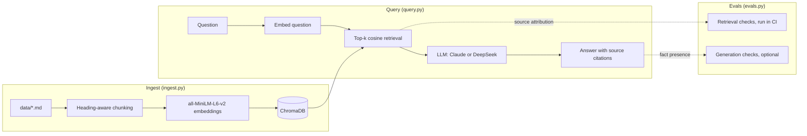

# rag-observability — RAG over Observability Docs

[](https://github.com/redbarron23/rag-observability/actions/workflows/ci.yml)
[](../LICENSE)


A Retrieval-Augmented Generation system that answers natural-language questions about multi-cloud observability architecture, coverage targets, and monitoring standards.

Ask questions and get **cited answers** grounded in the actual documentation:

```
Q: What is the coverage target for Tier 1 production resources?
A: The production Tier 1 coverage target is 85% within 4 months and 100%
   within 9 months (source: coverage-targets.md, section 'Tier 1').
```

## Architecture at a glance



## Quick start

```bash
# 1. Set up
python -m venv .venv && source .venv/bin/activate
pip install -r requirements.txt

# 2. Set your API key (Anthropic is default)
export ANTHROPIC_API_KEY=sk-ant-...
# Or for DeepSeek:
# export DEEPSEEK_API_KEY=sk-...

# 3. Ingest — reads data/*.md, chunks, embeds, stores in local ChromaDB
python ingest.py

# 4. Ask questions (default provider: Anthropic; see Environment variables)
python query.py "What are the coverage targets for Azure production?"

# 5. Or use DeepSeek instead
python query.py --provider deepseek --model deepseek-chat "Explain the observability framework"

# 6. Set provider via environment variable (no flag needed each time)
export LLM_PROVIDER=deepseek
export LLM_MODEL=deepseek-chat
python query.py "What are the top monitoring gaps?"

# 7. Interactive REPL
python query.py

# 8. Run evals (retrieval only — no API key needed)
python evals.py

# Full evals (default provider: Anthropic)
python evals.py --with-llm

# Full evals with DeepSeek
LLM_PROVIDER=deepseek LLM_MODEL=deepseek-chat python evals.py --with-llm
```

---

## The RAG pipeline (detailed)

```
                    INGEST (ingest.py)
                    ==================

                                     ┌──────────────────┐
                                     │  data/*.md       │
                                     │  sample corpus   │
                                     └────────┬─────────┘
                                              │
                                              ▼
                                     ┌──────────────────┐
                                     │ load_documents() │
                                     │ Walks data/      │
                                     │ recursively,     │
                                     │ skips <50 chars  │
                                     └────────┬─────────┘
                                              │
                                              ▼
                                     ┌──────────────────────────────────────┐
                                     │ chunk_text_simple(text, chunk_size) │
                                     │                                     │
                                     │ Groups paragraphs into chunks of    │
                                     │ ~500 chars each.  Each chunk gets   │
                                     │ a heading breadcrumb so it's        │
                                     │ self-contained when retrieved:      │
                                     │                                     │
                                     │   "Coverage Targets > Tier 1        │
                                     │                                     │
                                     │    The Tier 1 target is 85%..."     │
                                     └────────┬────────────────────────────┘
                                              │
                                              ▼
                                     ┌──────────────────────────────────────┐
                                     │ SentenceTransformer                 │
                                     │ all-MiniLM-L6-v2                    │
                                     │                                     │
                                     │ Each chunk → 384-dim vector         │
                                     │ Runs locally, model downloaded      │
                                     │ once from HuggingFace               │
                                     └────────┬────────────────────────────┘
                                              │
                                              ▼
                                     ┌──────────────────────────────────────┐
                                     │ ChromaDB (local vector store)       │
                                     │                                     │
                                     │ Collection: "observability-docs"    │
                                     │ Distance:  cosine                   │
                                     │                                     │
                                     │ Each entry:                         │
                                     │   id:        coverage-targets.md#2  │
                                     │   embedding: [384 floats]           │
                                     │   document:  "chunk text..."        │
                                     │   metadata:  {"source": "file.md",  │
                                     │                "section": "Title"}  │
                                     │                                     │
                                     │ Persisted to chroma_db/ on disk     │
                                     └──────────────────────────────────────┘


                    QUERY (query.py)
                    ================

    "What are the coverage targets?"
              │
              ▼
    ┌─────────────────────┐
    │ Embed the question  │
    │ (same model)        │
    └────────┬────────────┘
             │
             ▼
    ┌───────────────────────────────────────────────┐
    │ ChromaDB: cosine similarity search            │
    │ Returns top-6 chunks with their source/section│
    └────────┬──────────────────────────────────────┘
             │
             ▼
    ┌───────────────────────────────────────────────┐
    │ Build context with source citations           │
    │                                               │
    │ [Chunk 1] Source: coverage-targets.md         │
    │           Section: Tier 1                     │
    │ The production Tier 1 coverage target...      │
    │                                               │
    │ [Chunk 2] Source: tagging-standard.md         │
    │           Section: Required tags              │
    └────────┬──────────────────────────────────────┘
             │
             ▼
    ┌───────────────────────────────────────────────┐
    │ LLM (Claude by default)                      │
    │                                               │
    │ Prompt: "Answer using ONLY this context.      │
    │          Cite source and section for each     │
    │          claim."                              │
    │                                               │
    │ System: "Do NOT use any external knowledge."  │
    └────────┬──────────────────────────────────────┘
             │
             ▼
    "The Tier 1 target is 85% within 4 months
     (source: coverage-targets.md, section 'Tier 1')."
```

---

## File reference

| File | Purpose |
|---|---|
| `ingest.py` | One-shot ingestion pipeline: load → chunk → embed → store |
| `query.py` | Retrieval + generation: `RAGEngine` class with `retrieve()`, `answer()` and `answer_with_citations()` |
| `app.py` | Optional Streamlit interface for local retrieval, evidence inspection, and cited answers; install `requirements-ui.txt` and follow the [launch instructions](../README.md#local-web-interface) |
| `evals.py` | 15 answerable and 4 unanswerable cases: source attribution (retrieval-only, no API key), then facts, citations and declines (`--with-llm`) |
| `tests/` | Unit tests for loading, chunking, provider validation and eval fact matching (`pytest`) |
| `.github/workflows/ci.yml` | CI: lint (`ruff check`), unit tests, ingest sample corpus, retrieval evals |
| `chroma_db/` | Persisted vector store, regenerated by `ingest.py` (in `.gitignore`) |
| `data/` | Sample corpus: 8 fictional markdown docs for a made-up company (replace with your own) |

### Environment variables

| Variable | Purpose | Default |
|---|---|---|
| `LLM_PROVIDER` | LLM provider (`anthropic` or `deepseek`) | `anthropic` |
| `LLM_MODEL` | Model name (provider-specific) | `claude-sonnet-5-5` or `deepseek-chat` |
| `DEEPSEEK_API_KEY` | API key for DeepSeek | required for `deepseek` |
| `ANTHROPIC_API_KEY` | API key for Claude | required for `anthropic` |

Copy `.env.example` as a starting point.

### CLI flags

| Flag | Purpose | Default |
|---|---|---|
| `--provider` | Override LLM_PROVIDER for one query | env var |
| `--model` | Override LLM_MODEL for one query | env var |
| `--n-results` | Number of chunks to retrieve | `6` |
| `--verbose`, `-v` | Show retrieved chunks before the answer | `False` |
| `--persist-dir` | ChromaDB persistence directory | `chroma_db` |
| `--max-distance` | Drop chunks with cosine distance above this (`2` disables) | `0.6` |
| `--retrieval` | `vector` (embeddings only) or `hybrid` (embeddings + BM25 keywords); also on `evals.py` | `vector` |

---

## Chunking strategy

`chunk_text_simple()` in `ingest.py` is the core design choice. Key decisions:

### Heading-aware breadcrumbs

Each chunk prepends its parent headings as a breadcrumb trail. This means a chunk about Tier 1 coverage targets starts with `Coverage Targets > Tier 1` even when retrieved in isolation — it's self-contained.

Headings `#` to `####` are tracked as a stack: a new heading flushes the chunk in progress, pops any headings at the same or deeper level, and pushes itself. The chunk's `section` metadata is the deepest heading.

### Paragraph grouping, not character splitting

Documents are split on paragraph boundaries (blank lines), not mid-sentence. Paragraphs are added to the current chunk until the next one would push it past `--chunk-size` (default 500 characters); then the chunk is flushed and a new one starts. A single paragraph longer than the limit becomes its own chunk rather than being cut.

Wrapped lines stay in the same paragraph. The size target counts body text and paragraph separators; heading breadcrumbs are added outside that target.

This avoids the common RAG pitfall of chunks that start or end mid-sentence, which confuse the LLM.

### No overlap

`chunk_text_simple()` has no character overlap between chunks. The heading breadcrumb provides enough context that overlap isn't needed.

---

## Embedding model

`all-MiniLM-L6-v2` is a sentence-transformer model that maps sentences and paragraphs to 384-dimensional vectors. It's:

- **Small** — ~80MB, runs on CPU in a few seconds
- **Popular** — the most-downloaded model on HuggingFace, well-tested
- **English-optimized** — sufficient for technical documentation
- **Locally executed** — no API call, no data leaves your machine during embedding

The model is downloaded once on first run and cached locally (that's the `HF_TOKEN` warning — HuggingFace now requires authentication for higher rate limits, but the model is public).

---

## Retrieval: how it works

`RAGEngine.retrieve()` in [`query.py`](../query.py) embeds the question with the same model used for ingestion, runs a cosine-similarity query against ChromaDB for the top `--n-results` chunks (default 6), and returns each chunk's text with its `source`, `section` and `distance`.

Chunks with a cosine distance above `--max-distance` (default `0.6`; 0 = identical) are dropped; if nothing survives, the answer is "No relevant documents found." and no LLM call is made. The default comes from the eval questions: on the sample corpus the answerable questions find a relevant chunk within 0.57 and the unanswerable ones have nothing closer than 0.65. Pass `--max-distance 2` to keep all top-k (cosine distance tops out at 2), and re-measure the cutoff on your own documents.

### Hybrid retrieval (opt-in)

`--retrieval hybrid` adds keyword matching for exact terms that MiniLM embeddings blur, such as figures (`0.47%`), product names (`Ops Agent`) and tag names (`cost-centre`). It scores every chunk twice, by cosine distance and by [BM25](https://en.wikipedia.org/wiki/Okapi_BM25) over keyword tokens (decimals, percentages and hyphenated names stay whole), then merges the two rankings with reciprocal rank fusion (`k = 60`). Chunks with no query term get no keyword rank. The `--max-distance` cutoff still applies to every fused chunk, so a keyword match alone can't make an unanswerable question answerable. Hybrid mode loads the collection into memory on first use and scores it in pure Python, which suits local document sets of a few thousand chunks. BM25 is implemented in `query.py`; no extra dependency is needed.

Retrieval evals on the bundled corpus (top-6, 0.6 cutoff):

| Mode | Passed | Section recall @1 | @3 | @6 |
|---|---|---|---|---|
| `vector` (default) | 21/21 | 12/20 | 19/20 | 20/20 |
| `hybrid` | 21/21 | 14/20 | 19/20 | 20/20 |

Hybrid moves the supporting section to rank 1 for `tracing-use-cases` and `exact-basic-logs`, and from rank 3 to 2 for `exact-gcp-coverage-figure`; nothing ranks lower and all four unanswerable questions are still rejected. Vector stays the default because no case changes from fail to pass and generation evals (`--with-llm`) haven't been compared across the two modes. The two `short-*` cases pass in both modes because of the [exact-term margin](#exact-term-margin); without it they fail in both.

#### Exact-term margin

Short questions about a named thing embed poorly. For "What does the Ops Agent do?" and "What is last_updated used for?" the right chunk ranks first at distance 0.637 and 0.641, so a plain 0.6 cutoff drops it and the question goes unanswered. A chunk up to `EXACT_TERM_MARGIN` (0.1) beyond `--max-distance` is therefore kept when it contains, as a whole word, an exact term from the question:

- identifiers: tokens with `_`, `-`, `.` or `%`, or that mix letters and digits (`last_updated`, `cost-centre`, `0.47%`, `p95`), at least three characters long;
- multi-word names: runs of two or more capitalised words after the question's first word (`Ops Agent`, `Basic Logs`).

Single capitalised words such as `GCP` don't count; they appear throughout the corpus. BM25 scores were not usable as the signal: on 37 chunks, generic words like "month" score as high as "ops". The margin applies in both retrieval modes and only to chunks already in the ranked results. On the bundled corpus the closest chunk to each unanswerable question is at 0.652 or more and contains none of its exact terms, so all four are still rejected. A question that names a real term but asks something the documents don't cover (for example the Ops Agent's price) can still retrieve that chunk; the model then has to decline.

Chunk IDs are `<source>#<index>` (e.g. `reference/coverage-targets.md#2`), so editing one document doesn't renumber the chunks of every other document.

---

## Generation: the cited answer

`RAGEngine.answer()` constructs a prompt from the retrieved chunks, then delegates to `_call_llm()` which routes to the configured provider.

### Provider selection

The provider is determined by (in priority order):
1. `--provider` CLI flag
2. `LLM_PROVIDER` environment variable
3. Default: `anthropic`

Each provider has a default model (`claude-sonnet-5-5` for Anthropic, `deepseek-chat` for DeepSeek), which `LLM_MODEL` or `--model` overrides. An unknown provider name is an error. The defaults live in `DEFAULT_PROVIDER` and `PROVIDER_DEFAULT_MODELS` at the top of [`query.py`](../query.py).

### Anthropic path

Uses `anthropic.Anthropic().beta.messages.create()` with the `system` parameter for the system prompt and `max_tokens=16000`, since Sonnet 5.5 always thinks and thinking counts against the limit. Server-side refusal fallback is enabled (`fallbacks="default"`).

The Anthropic path uses Claude's native citations instead of asking the model to write them. Each retrieved chunk is sent as a plain-text `document` content block with `citations: {"enabled": true}` and a title of `<source>, section '<Section>'`, followed by the question as a text block. The response arrives split into text blocks (thinking blocks are skipped); each cited block carries citations giving the exact cited text and the index of the document it came from. `_call_anthropic()` maps each citation back to its chunk's source and section, and appends a `(source: <document>.md, section '<Section>')` marker after each cited block, so the answer looks the same as a prompt-cited one in the CLI and the web interface.

`RAGEngine.answer_with_citations()` returns `(answer, chunks, citations)`, where each citation is a dict with `source`, `section`, `chunk` (1-based rank) and `cited_text`. `citations` is `None` for DeepSeek. `answer()` keeps returning `(answer, chunks)`. The CLI prints a numbered **Citations** list with the quoted text after an Anthropic answer.

### DeepSeek path (OpenAI-compatible)

Uses `openai.OpenAI()` pointed at `https://api.deepseek.com`. The system prompt is injected as the first `{"role": "system"}` message in the messages array (OpenAI convention). DeepSeek has no native citations, so it keeps the prompt-based citations described below.

### System prompts

`SYSTEM_PROMPT` in [`query.py`](../query.py) is used for DeepSeek. It casts the model as an observability expert, tells it to answer only from the provided context (and to say so when the context isn't enough), and requires a citation for every factual claim in the form `(source: <document>.md, section '<Section>')`. `ANTHROPIC_SYSTEM_PROMPT` gives Claude the same instructions without the written citation format, since the API attaches citations itself.

Three constraints enforced:
1. **No external knowledge** — if it's not in the retrieved chunks, the model must say so
2. **Citation required** — every factual claim must cite its source
3. **Precision** — technical infrastructure docs need exact numbers and references

### User prompt (DeepSeek)

The user message repeats the "only this context, cite each claim" instruction, then gives the question followed by the retrieved chunks. Each chunk is headed `[Chunk N] Source: <file>, Section: <section>` so the model can cite it.

---

## Evaluation strategy

`evals.py` tests 15 answerable queries against known ground truth in the sample corpus, plus 4 questions the corpus can't answer. Answerable cases check **three dimensions:**

Provider errors fail the case and are reported separately. Dimension scores count only evaluated cases, with skipped cases shown as unevaluated; a provider failure never counts as a quality pass. For example, if every provider call fails, sources are reported as `0/0 (10 unevaluated)` and the command exits nonzero.

### Dimension 1: Source attribution

Did the RAG system retrieve chunks from the correct document(s)?

This checks the retrieved chunks' metadata, not the citations written in the answer text. Document attribution passes when every expected source appears among the top-6 retrieved chunks. It is reported separately from supporting-section recall.

**Example:** A question about tagging standards should return chunks from `tagging-standard.md`, not from `observability_framework.md`.

Retrieval-only evals also require the actual supporting sections. Each answerable case has an `expected_sections` list of exact `(source path, section name)` pairs, reviewed against the sample documents. All listed sections are required: onboarding needs both `Prerequisites` and `Onboarding steps`, while the tracing case needs `Latency investigation` and `Dependency mapping` to support its expected facts. These labels define the minimum evidence for the benchmark answer, rather than every potentially useful section.

Supporting-section recall at ranks 1, 3 and 6 is the number of required sections found within that cutoff divided by the total required sections across answerable cases. A question needing two sections contributes two to the denominator. Any chunk with the matching source and section can satisfy a requirement; duplicate chunks count only once, at their earliest rank. Matching a section name in another document does not count.

An answerable retrieval case passes only when document attribution passes and every required section appears in the top six. Lower cutoffs are diagnostic, not additional pass thresholds. Each case reports its first relevant rank (1-based, after the distance cutoff); `--verbose` and failed cases show every required section's rank or `missing`. If nothing is relevant, the first relevant rank is `missing`.

Retrieval for an unanswerable question passes when the distance cutoff drops every chunk.

### Dimension 2: Fact presence

Does the generated answer contain the expected factual content? Every expected fact must appear in the answer (see `contains_fact()` in [`evals.py`](../evals.py)).

**Example:** A question about coverage targets must mention "85%", "4 months", "100%", and "9 months" — the specific thresholds from the document.

`contains_fact()` matches case-insensitively and must start at a word boundary, so "4 months" doesn't match "14 months". Short generic facts like "100%" can still match by coincidence, so prefer specific ones.

### Dimension 3: Citations

Dimension 1 checks what was retrieved; this checks what the answer cites. On the Anthropic path, `citation_problems()` uses the structured citations returned by the API (the source of each cited document). For DeepSeek, it parses the `(source: X.md, section '…')` citations out of the answer text. Either way, it fails the case if there are no citations, if one names a document that wasn't retrieved, or if none names the expected source. For parsed citations, the directory may be dropped (`coverage-targets.md` matches `reference/coverage-targets.md`). Cited sections aren't checked.

### Unanswerable questions

The system prompt tells the model to say so when the context can't answer. Four questions on observability-adjacent topics the corpus doesn't cover (an on-call rota, vendor pricing, a Kubernetes version, an outage root cause) check this. In `--with-llm` mode they run **without** the distance cutoff, so the model sees the nearest chunks and has to decline on its own; `is_decline()` looks for phrases like "does not contain" or "not in the provided context". It doesn't detect an answer that declines and then guesses anyway.

### Why both checks?

Most RAG evals only check retrieval recall (did we get the right chunks?). But a system that retrieves the right document and then hallucinates a wrong answer still fails in production. Conversely, a system that gets the facts right but retrieved them from the wrong document is also broken — attribution errors erode user trust.

The retrieval and fact checks catch both failure modes (the citation check adds a third: the right document was retrieved, but the answer cites another):

| Retrieval | Facts | Outcome |
|---|---|---|
| ✅ Correct source | ✅ Correct facts | **PASS** |
| ✅ Correct source | ❌ Hallucinated | **FAIL** — fact error |
| ❌ Wrong source | ✅ Correct facts | **FAIL** — attribution error |
| ❌ Wrong source | ❌ Wrong facts | **FAIL** — both errors |

### The eval cases

| ID | Question | Expected source | Expected facts |
|---|---|---|---|
| `coverage-targets-tier1` | Tier 1 production target | `reference/coverage-targets.md` | 85%, 4 months, 100%, 9 months |
| `coverage-targets-gcp` | Current GCP coverage | `reference/coverage-targets.md` | 0.47%, 40% |
| `framework-scoring` | Scoring model | `architecture/observability_framework.md` | Missing, Basic, Good, Excellent |
| `framework-categories` | Framework categories | `architecture/observability_framework.md` | Metrics, Logs, Traces, Alerts, SLO, Ownership |
| `gcp-azure-metrics-differences` | GCP vs Azure metrics | `reference/gcp-azure-metrics-comparison.md` | Ops Agent, Azure Monitor Agent |
| `tagging-standard` | Resource tagging | `reference/tagging-standard.md` | owner, cost-centre, environment |
| `tracing-use-cases` | Distributed tracing | `architecture/observability_tracing_use_cases.md` | dependency, latency |
| `data-first-approach` | Data freshness | `data-first-approach.md` | 6 hours |
| `observability-setup` | Onboarding a service | `observability-setup-primer.md` | owning team, SLO |
| `cost-smoothing` | Log Analytics cost plan | `programme/COST_SMOOTHING.md` | 20%, three waves |
| `exact-gcp-coverage-figure` | Which cloud is at 0.47% | `reference/coverage-targets.md` | GCP |
| `exact-ops-agent` | Ops Agent collection and config | `reference/gcp-azure-metrics-comparison.md` | host metrics, YAML |
| `exact-tag-values` | `environment` and `tier` tag values | `reference/tagging-standard.md` | prod, staging, dev |
| `exact-tag-enforcement` | Missing `owner` or `cost-centre` tag | `reference/tagging-standard.md` | Azure Policy, 30 days |
| `exact-basic-logs` | Tables moved to Basic Logs | `programme/COST_SMOOTHING.md` | high-volume, 30 days |

The `exact-*` cases use figures, product names and tag names, where keyword matching should help most (issue #8).

Unanswerable (expected to decline): `unanswerable-oncall-rota`, `unanswerable-vendor-pricing`, `unanswerable-k8s-version`, `unanswerable-outage-root-cause`.

### Latest results

| Mode | Cases | Passed |
|---|---|---|
| Retrieval (document attribution + supporting sections + cutoff), no API key | 21 | 21 (100%) |
| Full, generation with DeepSeek (facts, citations, declines), before the `exact-*` cases | 14 | 14 (100%) |

Both modes use the same top-6 retrieval. Earlier, generation used top-4 and missed the 'Dependency mapping' chunk (ranked 6th) for `tracing-use-cases`, so the answer lacked that use case. Raising the default to 6 fixed it. Retrieval evals run in CI.

Retrieval-only evals run in CI and exit non-zero on any failure, including missing supporting sections. All 21 pass locally (top-6 vector retrieval, 0.6 cutoff with the exact-term margin). Document attribution is 17/17 answerable cases; supporting-section recall is 12/20 at rank 1, 19/20 at rank 3, and 20/20 at rank 6 (see [hybrid retrieval](#hybrid-retrieval-opt-in) for the hybrid numbers). These section metrics exclude the four unanswerable cases, which are scored by rejection instead. The full-generation result above is the earlier DeepSeek run; generation was not rerun for the section-check change or the `exact-*` and `short-*` cases.

---

## Usage examples

```bash
# Ingest with custom chunk size
python ingest.py --data-dir data --chunk-size 600

# Re-embed every document instead of reusing unchanged embeddings
python ingest.py --rebuild

# Single query (default provider)
python query.py "What are the top monitoring gaps identified?"

# Verbose — shows the retrieved chunks before the LLM answer
python query.py --verbose "Explain the observability framework"

# Specify provider and model per-query
python query.py --provider deepseek --model deepseek-chat "What is the scoring model?"

# Control how many chunks are retrieved (default: 6)
python query.py --n-results 6 "What is the process for running a gap analysis?"

# Use environment variables to set provider persistently
export LLM_PROVIDER=deepseek
export LLM_MODEL=deepseek-chat
python query.py "What are the tagging standards?"

# Interactive REPL (shows active provider at startup)
python query.py

# Run evals (retrieval only — no API key needed)
python evals.py
python evals.py --verbose

# Full evals with fact, citation and decline checks (requires API key)
python evals.py --with-llm
```

## Data handling

`data/` ships with a small **fictional** sample corpus (a made-up "Contoso Cloud" observability programme) so the project runs out of the box and CI can verify retrieval. `chroma_db/` is generated from it and is in `.gitignore`.

### Indexed corpus provenance and freshness

Each newly built collection stores a versioned JSON `corpus_manifest` in its Chroma metadata: UTC ingestion time, original absolute source directory, SHA-256 hashes of loaded Markdown files, a combined corpus hash, embedding-model identifier, and chunk size. Chunk metadata also includes its source hash. Hashes use original file bytes; the combined hash covers the sorted source-path/hash mapping. The embedding revision is explicitly `null` because ingestion does not pin or resolve a model revision. The manifest contains no document text or provider credentials, but does contain local paths.

`python query.py --verbose "your question"` prints the indexed timestamp, corpus hash, and embedding model before the answer, including when no relevant chunks match. Existing readers retain provenance for their loaded collection after another process rebuilds the index; reload to use the replacement. Indexes created without a manifest remain queryable and report provenance as unavailable until re-ingested.

Check the active index against local sources without loading the embedding model or calling a provider:

```bash
python ingest.py --check
python ingest.py --check --persist-dir /path/to/index
# If the source directory has moved, compare against its new location:
python ingest.py --check --persist-dir /path/to/index --data-dir /new/path/to/docs
```

The JSON result reports `current`, `stale` (with added, modified, and deleted relative paths), or `unavailable` (with a reason). Exit codes are **0**, **1**, and **2**, respectively. By default the check uses the directory recorded at ingestion, regardless of the current working directory. Missing directories, unreadable files/directories, and missing provenance are unavailable rather than evidence of freshness. Newly added stubs shorter than 50 trimmed characters and non-Markdown files are excluded, matching ingestion; shortening an indexed document is reported as a modification. A successful rebuild removes documents that no longer qualify.

This is an explicit local snapshot check; queries do not automatically check freshness. Avoid editing sources during ingestion or the check. Remote synchronization is outside this feature.

### Incremental ingestion

`python ingest.py` (and **Upload and index**) compares each loaded file's SHA-256 with the active collection's manifest. A file whose hash, chunk text, section, and per-chunk `source_sha256` all match reuses its stored embeddings; added and changed files are embedded, and files that were deleted (or no longer qualify) are dropped. When nothing was added, changed, or deleted and the source directory is the one recorded, ingestion reports that the index is up to date, embeds nothing, and leaves the active collection in place. Deleting files only does not load the embedding model.

Any change still builds a complete new collection — unchanged chunks are copied with their stored embeddings — and verifies its chunk count before the `active-collection` pointer switches, so a failed update leaves the previous index active exactly as a full rebuild does.

All files are re-embedded when you pass `--rebuild`, when the active index has no supported manifest, or when it was built with a different embedding model or `--chunk-size`. Use `--rebuild` after changing the embedding model version installed locally, since the manifest records the model name but not its revision.

### Add documents in the web interface

For ready-to-upload fictional examples, use the three files in [upload-samples](upload-samples/) and follow the [manual test plan](upload-test-plan.md), which includes expected answers and a known cross-document retrieval failure.

1. Open **Add documents** in the sidebar.
2. Choose one or more Markdown (`.md`) files, encoded as UTF-8. Each file must have at least 50 characters of usable text and be no larger than 5 MB. Empty or heading-only documents are rejected.
3. Click **Upload and index**. This saves files locally under `data/uploads/<content hash>/<filename>.md` and updates the selected index from the entire `data/` folder, including the sample corpus and all prior uploads. Only new or changed files are embedded (see [incremental ingestion](#incremental-ingestion)).
4. Wait for the success message, then click **Find sources** with a question about your document. The engine is reloaded automatically.

Uploads are excluded from Git. An identical file uploaded again reuses its saved path; different content with the same filename is saved separately, so old versions are not silently overwritten or removed. To retire an old version, remove its saved file from `data/uploads/`, rebuild with `python ingest.py`, and click **Reload index**. Uploading and embedding run locally; **Generate answer** sends retrieved text to the configured provider.

If indexing fails, saved documents remain available for a retry; the UI reports the failure instead of claiming they are searchable. Ingestion builds a separate collection and verifies its chunk count before atomically replacing the `active-collection` pointer in the index directory. A build, write, or switch failure leaves the previous index active. A successful rebuild excludes deleted source documents. Existing readers keep their previous collection until reloaded; the UI reloads after a successful upload. Indexes created before this pointer was introduced remain readable.

Previous and incomplete collections are retained, so rebuilds use additional disk space. Do not delete collections while readers may still use them. Run only one ingestion process per index directory; this local workflow does not coordinate concurrent writers. The switch protects against failed operations, but does not guarantee recovery from power loss. Uploads rebuild from `data/`; if you previously indexed another source directory into the selected index, its documents must also be present in `data/` to be retained. The interface is for a local user, not concurrent document administration.

### Add documents from the command line

Place `.md` files anywhere under `data/`; subfolders are read recursively. Files shorter than 50 characters after trimming are skipped. Use `#` through `####` headings for useful section breadcrumbs, for example:

```markdown
# Database Latency Runbook

## Investigation

Check slow queries, connection pool usage, and database CPU before escalating.

## Escalation

Contact the database owning team if latency persists.
```

Then rebuild and query:

```bash
python ingest.py
python query.py "Your question here"
```

In the web interface, click **Reload index** after a command-line rebuild. For an entirely separate corpus, use `python ingest.py --data-dir /path/to/docs --persist-dir /path/to/index` and choose that index directory in the UI; its upload button still rebuilds from `data/` as described above. PDF and HTML are not supported.

Add questions and expected source/section pairs in `evals.py` for your documents. Existing cases target the sample corpus, so replacing it requires corresponding eval changes. Additional documents can change retrieval rankings even when the samples remain. Don't commit confidential documents to a public repo; only the UI upload folder is excluded automatically.

---

## What this project demonstrates

| Concept | Implementation |
|---|---|
| **RAG pipeline** | End-to-end: ingest → chunk → embed → store → retrieve → generate |
| **Semantic chunking** | Heading-aware paragraph grouping with breadcrumb context |
| **Vector search** | ChromaDB with cosine similarity, `all-MiniLM-L6-v2` |
| **Cited generation** | LLM constrained to answer only from retrieved context, with mandatory source citations |
| **Provider abstraction** | `LLM_PROVIDER`/`LLM_MODEL` env vars or `--provider`/`--model` CLI flags; works with Anthropic and DeepSeek |
| **RAG evals** | Dual checks: source attribution + fact presence in generated answer |
| **Local-first** | Embedding runs locally on CPU; only the LLM call hits an API |

## Requirements

- Python 3.10+
- For generation, one of (retrieval and evals need no key):
  - `ANTHROPIC_API_KEY` for Claude (default provider)
  - `DEEPSEEK_API_KEY` for DeepSeek

### Dependencies

See [`requirements.txt`](../requirements.txt) (runtime) and [`requirements-dev.txt`](../requirements-dev.txt) (adds pytest and ruff). Each package has an upper bound on its major version so a breaking release can't reach CI unannounced; Dependabot opens PRs for updates.

## License

MIT

## References

- [ChromaDB — vector database](https://www.trychroma.com/products/chromadb) — the open-source embedding database used as the vector store in this project
- [RAG 101: Demystifying Retrieval-Augmented Generation Pipelines](https://developer.nvidia.com/blog/rag-101-demystifying-retrieval-augmented-generation-pipelines/) — NVIDIA blog post covering the fundamentals of RAG architecture, chunking strategies, embedding models, and evaluation
- [Sentence Transformers](https://www.sbert.net/) — library and model hub for dense vector embeddings (`all-MiniLM-L6-v2`)
- [Evaluating RAG: A Comprehensive Guide to Metrics and Methods](https://www.rungalileo.io/blog/evaluating-rag-a-comprehensive-guide-to-metrics-and-methods) — covers the dual-attribution eval strategy used in this project's `evals.py`
- [LangSmith RAG Evaluation](https://docs.smith.langchain.com/faq/evaluation/eval_rag) — production-grade RAG eval patterns (correctness, faithfulness, relevance)
