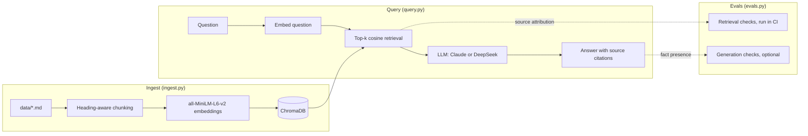

# rag-observability — RAG over Observability Docs

[](https://github.com/redbarron23/rag-observability/actions/workflows/ci.yml)
[](../LICENSE)


A Retrieval-Augmented Generation system that answers natural-language questions about multi-cloud observability architecture, coverage targets, and monitoring standards.

Ask questions and get **cited answers** grounded in the actual documentation:

```
Q: What is the coverage target for Tier 1 production resources?
A: The production Tier 1 coverage target is 85% within 4 months and 100%
   within 9 months (source: coverage-targets.md, section 'Tier 1').
```

## Architecture at a glance



## Quick start

```bash
# 1. Set up
python -m venv .venv && source .venv/bin/activate
pip install -r requirements.txt

# 2. Set your API key (Anthropic is default)
export ANTHROPIC_API_KEY=sk-ant-...
# Or for DeepSeek:
# export DEEPSEEK_API_KEY=sk-...

# 3. Ingest — reads data/*.md, chunks, embeds, stores in local ChromaDB
python ingest.py

# 4. Ask questions (default provider: Anthropic; see Environment variables)
python query.py "What are the coverage targets for Azure production?"

# 5. Or use DeepSeek instead
python query.py --provider deepseek --model deepseek-chat "Explain the observability framework"

# 6. Set provider via environment variable (no flag needed each time)
export LLM_PROVIDER=deepseek
export LLM_MODEL=deepseek-chat
python query.py "What are the top monitoring gaps?"

# 7. Interactive REPL
python query.py

# 8. Run evals (retrieval only — no API key needed)
python evals.py

# Full evals (default provider: Anthropic)
python evals.py --with-llm

# Full evals with DeepSeek
LLM_PROVIDER=deepseek LLM_MODEL=deepseek-chat python evals.py --with-llm
```

---

## The RAG pipeline (detailed)

```
                    INGEST (ingest.py)
                    ==================

                                     ┌──────────────────┐
                                     │  data/*.md       │
                                     │  sample corpus   │
                                     └────────┬─────────┘
                                              │
                                              ▼
                                     ┌──────────────────┐
                                     │ load_documents() │
                                     │ Walks data/      │
                                     │ recursively,     │
                                     │ skips <50 chars  │
                                     └────────┬─────────┘
                                              │
                                              ▼
                                     ┌──────────────────────────────────────┐
                                     │ chunk_text_simple(text, chunk_size) │
                                     │                                     │
                                     │ Groups paragraphs into chunks of    │
                                     │ ~500 chars each.  Each chunk gets   │
                                     │ a heading breadcrumb so it's        │
                                     │ self-contained when retrieved:      │
                                     │                                     │
                                     │   "Coverage Targets > Tier 1        │
                                     │                                     │
                                     │    The Tier 1 target is 85%..."     │
                                     └────────┬────────────────────────────┘
                                              │
                                              ▼
                                     ┌──────────────────────────────────────┐
                                     │ SentenceTransformer                 │
                                     │ all-MiniLM-L6-v2                    │
                                     │                                     │
                                     │ Each chunk → 384-dim vector         │
                                     │ Runs locally, model downloaded      │
                                     │ once from HuggingFace               │
                                     └────────┬────────────────────────────┘
                                              │
                                              ▼
                                     ┌──────────────────────────────────────┐
                                     │ ChromaDB (local vector store)       │
                                     │                                     │
                                     │ Collection: "observability-docs"    │
                                     │ Distance:  cosine                   │
                                     │                                     │
                                     │ Each entry:                         │
                                     │   id:        coverage-targets.md#2  │
                                     │   embedding: [384 floats]           │
                                     │   document:  "chunk text..."        │
                                     │   metadata:  {"source": "file.md",  │
                                     │                "section": "Title"}  │
                                     │                                     │
                                     │ Persisted to chroma_db/ on disk     │
                                     └──────────────────────────────────────┘


                    QUERY (query.py)
                    ================

    "What are the coverage targets?"
              │
              ▼
    ┌─────────────────────┐
    │ Embed the question  │
    │ (same model)        │
    └────────┬────────────┘
             │
             ▼
    ┌───────────────────────────────────────────────┐
    │ ChromaDB: cosine similarity search            │
    │ Returns top-6 chunks with their source/section│
    └────────┬──────────────────────────────────────┘
             │
             ▼
    ┌───────────────────────────────────────────────┐
    │ Build context with source citations           │
    │                                               │
    │ [Chunk 1] Source: coverage-targets.md         │
    │           Section: Tier 1                     │
    │ The production Tier 1 coverage target...      │
    │                                               │
    │ [Chunk 2] Source: tagging-standard.md         │
    │           Section: Required tags              │
    └────────┬──────────────────────────────────────┘
             │
             ▼
    ┌───────────────────────────────────────────────┐
    │ LLM (Claude by default)                      │
    │                                               │
    │ Prompt: "Answer using ONLY this context.      │
    │          Cite source and section for each     │
    │          claim."                              │
    │                                               │
    │ System: "Do NOT use any external knowledge."  │
    └────────┬──────────────────────────────────────┘
             │
             ▼
    "The Tier 1 target is 85% within 4 months
     (source: coverage-targets.md, section 'Tier 1')."
```

---

## File reference

| File | Purpose |
|---|---|
| `ingest.py` | One-shot ingestion pipeline: load → chunk → embed → store |
| `query.py` | Retrieval + generation: `RAGEngine` class with `retrieve()` and `answer()` |
| `evals.py` | 10 answerable and 4 unanswerable cases: source attribution (retrieval-only, no API key), then facts, citations and declines (`--with-llm`) |
| `tests/` | Unit tests for loading, chunking, provider validation and eval fact matching (`pytest`) |
| `.github/workflows/ci.yml` | CI: lint (`ruff check`), unit tests, ingest sample corpus, retrieval evals |
| `chroma_db/` | Persisted vector store, regenerated by `ingest.py` (in `.gitignore`) |
| `data/` | Sample corpus: 8 fictional markdown docs for a made-up company (replace with your own) |

### Environment variables

| Variable | Purpose | Default |
|---|---|---|
| `LLM_PROVIDER` | LLM provider (`anthropic` or `deepseek`) | `anthropic` |
| `LLM_MODEL` | Model name (provider-specific) | `claude-sonnet-5-5` or `deepseek-chat` |
| `DEEPSEEK_API_KEY` | API key for DeepSeek | required for `deepseek` |
| `ANTHROPIC_API_KEY` | API key for Claude | required for `anthropic` |

Copy `.env.example` as a starting point.

### CLI flags

| Flag | Purpose | Default |
|---|---|---|
| `--provider` | Override LLM_PROVIDER for one query | env var |
| `--model` | Override LLM_MODEL for one query | env var |
| `--n-results` | Number of chunks to retrieve | `6` |
| `--verbose`, `-v` | Show retrieved chunks before the answer | `False` |
| `--persist-dir` | ChromaDB persistence directory | `chroma_db` |
| `--max-distance` | Drop chunks with cosine distance above this (`2` disables) | `0.6` |

---

## Chunking strategy

`chunk_text_simple()` in `ingest.py` is the core design choice. Key decisions:

### Heading-aware breadcrumbs

Each chunk prepends its parent headings as a breadcrumb trail. This means a chunk about Tier 1 coverage targets starts with `Coverage Targets > Tier 1` even when retrieved in isolation — it's self-contained.

Headings `#` to `####` are tracked as a stack: a new heading flushes the chunk in progress, pops any headings at the same or deeper level, and pushes itself. The chunk's `section` metadata is the deepest heading.

### Paragraph grouping, not character splitting

Documents are split on paragraph boundaries (blank lines), not mid-sentence. Paragraphs are added to the current chunk until the next one would push it past `--chunk-size` (default 500 characters); then the chunk is flushed and a new one starts. A single paragraph longer than the limit becomes its own chunk rather than being cut.

This avoids the common RAG pitfall of chunks that start or end mid-sentence, which confuse the LLM.

### No overlap

`chunk_text_simple()` has no character overlap between chunks. The heading breadcrumb provides enough context that overlap isn't needed.

---

## Embedding model

`all-MiniLM-L6-v2` is a sentence-transformer model that maps sentences and paragraphs to 384-dimensional vectors. It's:

- **Small** — ~80MB, runs on CPU in a few seconds
- **Popular** — the most-downloaded model on HuggingFace, well-tested
- **English-optimized** — sufficient for technical documentation
- **Locally executed** — no API call, no data leaves your machine during embedding

The model is downloaded once on first run and cached locally (that's the `HF_TOKEN` warning — HuggingFace now requires authentication for higher rate limits, but the model is public).

---

## Retrieval: how it works

`RAGEngine.retrieve()` in [`query.py`](../query.py) embeds the question with the same model used for ingestion, runs a cosine-similarity query against ChromaDB for the top `--n-results` chunks (default 6), and returns each chunk's text with its `source`, `section` and `distance`.

Chunks with a cosine distance above `--max-distance` (default `0.6`; 0 = identical) are dropped; if nothing survives, the answer is "No relevant documents found." and no LLM call is made. The default comes from the eval questions: on the sample corpus every answerable question has a relevant chunk within 0.34, the unanswerable ones have nothing closer than 0.65, and no expected fact or source is lost at any cutoff from 0.55 to 0.65. Pass `--max-distance 2` to keep all top-k (cosine distance tops out at 2), and re-measure the cutoff on your own documents.

Chunk IDs are `<source>#<index>` (e.g. `reference/coverage-targets.md#2`), so editing one document doesn't renumber the chunks of every other document.

---

## Generation: the cited answer

`RAGEngine.answer()` constructs a prompt from the retrieved chunks, then delegates to `_call_llm()` which routes to the configured provider.

### Provider selection

The provider is determined by (in priority order):
1. `--provider` CLI flag
2. `LLM_PROVIDER` environment variable
3. Default: `anthropic`

Each provider has a default model (`claude-sonnet-5-5` for Anthropic, `deepseek-chat` for DeepSeek), which `LLM_MODEL` or `--model` overrides. An unknown provider name is an error. The defaults live in `DEFAULT_PROVIDER` and `PROVIDER_DEFAULT_MODELS` at the top of [`query.py`](../query.py).

### Anthropic path

Uses `anthropic.Anthropic().beta.messages.create()` with the `system` parameter for the system prompt and `max_tokens=16000`, since Sonnet 5.5 always thinks and thinking counts against the limit. Server-side refusal fallback is enabled (`fallbacks="default"`), and the answer is built from the response's text blocks, skipping thinking blocks.

### DeepSeek path (OpenAI-compatible)

Uses `openai.OpenAI()` pointed at `https://api.deepseek.com`. The system prompt is injected as the first `{"role": "system"}` message in the messages array (OpenAI convention).

### System prompt (same for both providers)

`SYSTEM_PROMPT` in [`query.py`](../query.py) is shared by both providers. It casts the model as an observability expert, tells it to answer only from the provided context (and to say so when the context isn't enough), and requires a citation for every factual claim in the form `(source: <document>.md, section '<Section>')`.

Three constraints enforced:
1. **No external knowledge** — if it's not in the retrieved chunks, the model must say so
2. **Citation required** — every factual claim must cite its source
3. **Precision** — technical infrastructure docs need exact numbers and references

### User prompt

The user message repeats the "only this context, cite each claim" instruction, then gives the question followed by the retrieved chunks. Each chunk is headed `[Chunk N] Source: <file>, Section: <section>` so the model can cite it.

---

## Evaluation strategy

`evals.py` tests 10 answerable queries against known ground truth in the sample corpus, plus 4 questions the corpus can't answer. Answerable cases check **three dimensions:**

### Dimension 1: Source attribution

Did the RAG system retrieve chunks from the correct document(s)?

This checks the retrieved chunks' metadata, not the citations written in the answer text. A case passes when every expected source appears among the top-6 retrieved chunks.

**Example:** A question about tagging standards should return chunks from `tagging-standard.md`, not from `observability_framework.md`.

Retrieval for an unanswerable question passes when the distance cutoff drops every chunk.

### Dimension 2: Fact presence

Does the generated answer contain the expected factual content? Every expected fact must appear in the answer (see `contains_fact()` in [`evals.py`](../evals.py)).

**Example:** A question about coverage targets must mention "85%", "4 months", "100%", and "9 months" — the specific thresholds from the document.

`contains_fact()` matches case-insensitively and must start at a word boundary, so "4 months" doesn't match "14 months". Short generic facts like "100%" can still match by coincidence, so prefer specific ones.

### Dimension 3: Citations

Dimension 1 checks what was retrieved; this checks what the model wrote. `citation_problems()` parses the `(source: X.md, section '…')` citations out of the answer and fails the case if there are none, if one names a document that wasn't retrieved, or if none names the expected source. The directory may be dropped (`coverage-targets.md` matches `reference/coverage-targets.md`). Cited sections aren't checked.

### Unanswerable questions

The system prompt tells the model to say so when the context can't answer. Four questions on observability-adjacent topics the corpus doesn't cover (an on-call rota, vendor pricing, a Kubernetes version, an outage root cause) check this. In `--with-llm` mode they run **without** the distance cutoff, so the model sees the nearest chunks and has to decline on its own; `is_decline()` looks for phrases like "does not contain" or "not in the provided context". It doesn't detect an answer that declines and then guesses anyway.

### Why both checks?

Most RAG evals only check retrieval recall (did we get the right chunks?). But a system that retrieves the right document and then hallucinates a wrong answer still fails in production. Conversely, a system that gets the facts right but retrieved them from the wrong document is also broken — attribution errors erode user trust.

The retrieval and fact checks catch both failure modes (the citation check adds a third: the right document was retrieved, but the answer cites another):

| Retrieval | Facts | Outcome |
|---|---|---|
| ✅ Correct source | ✅ Correct facts | **PASS** |
| ✅ Correct source | ❌ Hallucinated | **FAIL** — fact error |
| ❌ Wrong source | ✅ Correct facts | **FAIL** — attribution error |
| ❌ Wrong source | ❌ Wrong facts | **FAIL** — both errors |

### The eval cases

| ID | Question | Expected source | Expected facts |
|---|---|---|---|
| `coverage-targets-tier1` | Tier 1 production target | `reference/coverage-targets.md` | 85%, 4 months, 100%, 9 months |
| `coverage-targets-gcp` | Current GCP coverage | `reference/coverage-targets.md` | 0.47%, 40% |
| `framework-scoring` | Scoring model | `architecture/observability_framework.md` | Missing, Basic, Good, Excellent |
| `framework-categories` | Framework categories | `architecture/observability_framework.md` | Metrics, Logs, Traces, Alerts, SLO, Ownership |
| `gcp-azure-metrics-differences` | GCP vs Azure metrics | `reference/gcp-azure-metrics-comparison.md` | Ops Agent, Azure Monitor Agent |
| `tagging-standard` | Resource tagging | `reference/tagging-standard.md` | owner, cost-centre, environment |
| `tracing-use-cases` | Distributed tracing | `architecture/observability_tracing_use_cases.md` | dependency, latency |
| `data-first-approach` | Data freshness | `data-first-approach.md` | 6 hours |
| `observability-setup` | Onboarding a service | `observability-setup-primer.md` | owning team, SLO |
| `cost-smoothing` | Log Analytics cost plan | `programme/COST_SMOOTHING.md` | 20%, three waves |

Unanswerable (expected to decline): `unanswerable-oncall-rota`, `unanswerable-vendor-pricing`, `unanswerable-k8s-version`, `unanswerable-outage-root-cause`.

### Latest results

| Mode | Cases | Passed |
|---|---|---|
| Retrieval (source attribution + cutoff), no API key | 14 | 14 (100%) |
| Full, generation with DeepSeek (facts, citations, declines) | 14 | 14 (100%) |

Both modes use the same top-6 retrieval. Earlier, generation used top-4 and missed the 'Dependency mapping' chunk (ranked 6th) for `tracing-use-cases`, so the answer lacked that use case. Raising the default to 6 fixed it. Retrieval evals run in CI.

Retrieval-only evals run in CI and exit non-zero on any failure. All 14 pass locally (top-6 retrieval, 0.6 cutoff).

---

## Usage examples

```bash
# Ingest with custom chunk size
python ingest.py --data-dir data --chunk-size 600

# Single query (default provider)
python query.py "What are the top monitoring gaps identified?"

# Verbose — shows the retrieved chunks before the LLM answer
python query.py --verbose "Explain the observability framework"

# Specify provider and model per-query
python query.py --provider deepseek --model deepseek-chat "What is the scoring model?"

# Control how many chunks are retrieved (default: 6)
python query.py --n-results 6 "What is the process for running a gap analysis?"

# Use environment variables to set provider persistently
export LLM_PROVIDER=deepseek
export LLM_MODEL=deepseek-chat
python query.py "What are the tagging standards?"

# Interactive REPL (shows active provider at startup)
python query.py

# Run evals (retrieval only — no API key needed)
python evals.py
python evals.py --verbose

# Full evals with fact, citation and decline checks (requires API key)
python evals.py --with-llm
```

## Data handling

`data/` ships with a small **fictional** sample corpus (a made-up "Contoso Cloud" observability programme) so the project runs out of the box and CI can verify retrieval. `chroma_db/` is generated from it and is in `.gitignore`.

To use your own documents:

```bash
# Replace the sample corpus with your markdown files (any directory structure)
rm -r data && cp -r /path/to/docs data

# Re-ingest (safe to re-run; the collection is rebuilt each time)
python ingest.py

# Query
python query.py "Your question here"
```

Update the cases in `evals.py` to match your documents. Don't commit confidential documents to a public repo.

---

## What this project demonstrates

| Concept | Implementation |
|---|---|
| **RAG pipeline** | End-to-end: ingest → chunk → embed → store → retrieve → generate |
| **Semantic chunking** | Heading-aware paragraph grouping with breadcrumb context |
| **Vector search** | ChromaDB with cosine similarity, `all-MiniLM-L6-v2` |
| **Cited generation** | LLM constrained to answer only from retrieved context, with mandatory source citations |
| **Provider abstraction** | `LLM_PROVIDER`/`LLM_MODEL` env vars or `--provider`/`--model` CLI flags; works with Anthropic and DeepSeek |
| **RAG evals** | Dual checks: source attribution + fact presence in generated answer |
| **Local-first** | Embedding runs locally on CPU; only the LLM call hits an API |

## Requirements

- Python 3.10+
- For generation, one of (retrieval and evals need no key):
  - `ANTHROPIC_API_KEY` for Claude (default provider)
  - `DEEPSEEK_API_KEY` for DeepSeek

### Dependencies

See [`requirements.txt`](../requirements.txt) (runtime) and [`requirements-dev.txt`](../requirements-dev.txt) (adds pytest and ruff). Each package has an upper bound on its major version so a breaking release can't reach CI unannounced; Dependabot opens PRs for updates.

## License

MIT

## References

- [ChromaDB — vector database](https://www.trychroma.com/products/chromadb) — the open-source embedding database used as the vector store in this project
- [RAG 101: Demystifying Retrieval-Augmented Generation Pipelines](https://developer.nvidia.com/blog/rag-101-demystifying-retrieval-augmented-generation-pipelines/) — NVIDIA blog post covering the fundamentals of RAG architecture, chunking strategies, embedding models, and evaluation
- [Sentence Transformers](https://www.sbert.net/) — library and model hub for dense vector embeddings (`all-MiniLM-L6-v2`)
- [Evaluating RAG: A Comprehensive Guide to Metrics and Methods](https://www.rungalileo.io/blog/evaluating-rag-a-comprehensive-guide-to-metrics-and-methods) — covers the dual-attribution eval strategy used in this project's `evals.py`
- [LangSmith RAG Evaluation](https://docs.smith.langchain.com/faq/evaluation/eval_rag) — production-grade RAG eval patterns (correctness, faithfulness, relevance)
